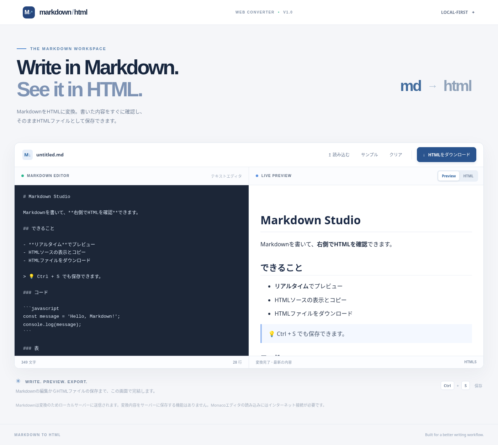

# Markdown to HTML

Markdown をブラウザで編集し、Python サーバーで HTML に変換して即時プレビューし、そのまま独立した `.html` ファイルとしてダウンロードする Web アプリケーションです。Recursion「Markdown to HTML」の実装課題向けプロジェクトです。



## 主要機能

| 機能 | 説明 |
|---|---|
| Markdown の編集 | Monaco Editor を CDN から読み込む。ネット接続がない場合は機能する `textarea` に自動切替 |
| Markdown → HTML | Python サーバーの `/api/convert` で変換 (`markdown-it-py`) |
| リアルタイムプレビュー | 編集後 180 ms のデバウンス。`iframe sandbox` に出力 |
| HTML ソース | **HTML** タブで完成文書のコード全体を確認し、コピー |
| ダウンロード | HTML と CSS を含む**単体で開けるHTMLファイル**を保存。`Ctrl+S` / `Cmd+S` も対応 |
| 入出力の補助 | `.md`/`.txt` 読み込み、クリア、サンプル挿入、文字数・行数表示 |
| 基本的な安全対策 | Markdown 内の HTML を無効化し、出力タグ/属性/URLスキームを検査。入力サイズ上限あり |
| レスポンシブ | PCでは左右2カラム、狭い画面では縦並び |

## 使用技術と役割

- **HTML5/CSS3** — フォーム、編集領域、2ペインUI、レスポンシブ表示
- **JavaScript（ブラウザ）** — イベント処理、`fetch`、Monaco導入、Blobダウンロード
- **Monaco Editor** — コード編集UI。CDNにアクセスできないときは標準textareaで代替
- **Python 3** — 標準ライブラリの `ThreadingHTTPServer` による Web サーバー
- **markdown-it-py** — CommonMark形式のMarkdownをHTMLへ変換。表・取り消し線に対応
- **bleach** — 変換されたHTMLのタグ、属性、URLプロトコルの許可リスト方式によるサニタイズ
- **unittest** — 変換ロジックと実HTTP通信を検証（標準ライブラリ）
- **Playwright + Chromium** — UI動作の任意の追加スモークテスト（通常の起動には不要）

外部APIキー、データベース、Node.js、npmは不要です。

## すぐ起動する（Windows + WSL2 Ubuntu）

初回セットアップ（プロジェクトフォルダー内で実行）：

```bash
cd ~/Markdown-to-HTML
python3 --version
python3 -m venv .venv
source .venv/bin/activate
python -m pip install -r requirements.txt
```

`python3 -m venv .venv` が失敗する場合は Ubuntu で `sudo apt update && sudo apt install -y python3-venv` を実行してください。`cd` のパスは実際に展開したディレクトリに読み替えます（WSL の Windows ダウンロード先を使う場合は例：`/mnt/c/Users/<WINDOWS_USER>/Downloads/Markdown-to-HTML`）。

サーバー起動：

```bash
python server.py
```

ブラウザで **http://127.0.0.1:8000/** を開いてください。

- **終了**：ターミナルで `Ctrl+C`
- **次回の起動**：`source .venv/bin/activate && python server.py`
- **ポート変更**：`PORT=9000 python server.py`
- **LAN公開**：`HOST=0.0.0.0 python server.py`（信頼できるネットワークのみ）
- **依存関係**：初回 `pip install` 時にはインターネット接続が必要。以降は、Monacoを除いて基本機能はオフラインで動きます。

## テスト

```bash
python -m unittest discover -s tests -p 'test_*.py' -v
python -m py_compile server.py src/converter.py
```

UIの追加テスト（任意、開発環境用）：

```bash
python -m pip install playwright
python -m playwright install chromium
python tests/browser_check.py
```

`browser_check.py` は、ローカルのHTML/CSS/JSとモック変換レスポンスを利用するUIスモークテストです。実際のHTTP通信は `test_server.py` が別途確認しています。デスクトップ画面のスクリーンショットは `docs/screenshot-desktop.png` にあります。モバイルでは DOM・幅・操作応答を確認していますが、本実行環境でのiframeの画像キャプチャは制限があります。環境によっては Playwright の Chromium パスを `CHROMIUM_PATH=/path/to/chromium` で指定してください。

### 手動動作確認

1. `# 見出し` と入力して右側が見出し表示に変わるか確認。
2. `**太字**`、リスト、表、コードブロックを入力して表示を確認。
3. **HTML** タブに切り替え、ソースに `<h1>` があるか確認。
4. **HTMLをダウンロード** を押し、保存した `.html` をサーバー停止後もブラウザで開けるか確認。
5. `.md` ファイルを読み込んでプレビューされるか確認。
6. 狭いブラウザ幅で2ペインが縦に並ぶか確認。
7. `<script>alert(1)</script>` をMarkdownに入力し、プレビューでスクリプトが実行されないことを確認。

## ディレクトリ構成

```text
Markdown-to-HTML/
├── server.py                  # HTTPルーティング、JSON API、静的ファイル配信
├── requirements.txt           # Python依存関係
├── Dockerfile                 # コンテナ実行用
├── .dockerignore
├── .gitignore
├── src/
│   ├── __init__.py
│   └── converter.py           # Markdownの変換と独立HTML生成
├── public/
│   ├── index.html             # UI構造
│   ├── styles.css             # UIデザイン
│   └── app.js                 # 編集・リアルタイム変換・ダウンロード
├── tests/
│   ├── test_converter.py      # 変換・安全性の単体テスト
│   ├── test_server.py         # 実HTTPサーバーの結合テスト
│   └── browser_check.py      # ブラウザUIの任意テスト
├── scripts/
│   └── run.sh                 # 起動用補助コマンド
├── docs/
│   ├── requirements.md        # 要件対応表
│   ├── test-report.md         # 実測テスト結果・未検証範囲
│   ├── deployment.md          # 本番公開・HTTPS・独自ドメイン設定
│   └── screenshot-desktop.png # デスクトップ画面の記録
└── learning/
    ├── 00_START_HERE.md       # 最短学習ガイド
    ├── 01_ARCHITECTURE.md     # 設計と依存関係
    ├── 02_KEY_CONCEPTS.md     # 文法・仕組み・技術の基礎
    ├── 03_EXECUTION_FLOW.md   # 詳細な実行トレース
    ├── 04_DEBUGGING.md        # デバッグ手順
    ├── 05_REVIEW.md           # 演習と模範解答
    └── code-walkthrough/      # 各主要ファイルの全文と逐次解説
```

## API仕様

`POST /api/convert`、Content-Type `application/json`。

入力例：

```json
{"markdown":"# Hello\n\n**World**"}
```

成功時 HTTP 200：

```json
{
  "html": "<h1>Hello</h1>\n<p><strong>World</strong></p>\n",
  "document": "<!doctype html>\n<html lang=...（HTML文書全文）"
}
```

`html` は安全化したHTML断片、`document` はスタイルを埋め込んだHTML文書全文です。

エラー：HTTP 400（不正JSON）、411（Content-Length不在）、413（サイズ超過）、415（JSON以外のContent-Type）、422（markdownの型不一致）、404（不明なURL）。Markdown は最大20万文字、POST本文は最大80万バイトです。

## 設計上の注意点

- サーバーに**ユーザーの文書を保存する機能はありません**。再読み込みするとサンプルに戻ります。
- `iframe sandbox=""` とサニタイズを併用します。HTMLの文書化やローカルファイルでの閲覧も考慮し、スクリプトの入ったMarkdownをそのままHTMLとして出力しません。
- HTMLの一部（生HTML、数式拡張、Mermaidなど）は対応しません。CommonMarkを基本とする一般的なMarkdown向けです。
- MonacoはjsDelivr CDN経由です。CDNが利用できない場合はテキストエディタを使います。**Monacoのネットワーク接続が常に成功することは保証されません**。
- HTMLから読み込む外部画像は、画像のURLにインターネット接続できる場合にのみ表示されます。
- 標準ライブラリのHTTPサーバーは学習・小規模なデモ用です。本番公開する場合はリバースプロキシ、HTTPS、監視、アクセス制限等を検討してください（`docs/deployment.md`）。

## GitHubで公開してRecursionへ提出する

初回の新規リポジトリ作成（GitHub CLIでログイン済みの場合）：

```bash
git init
git status
cat .gitignore
git add .
git commit -m "Build Markdown to HTML web app"
git branch -M main
gh auth login
gh repo create Markdown-to-HTML --public --source=. --remote=origin --push
```

ブラウザで GitHub に空のリポジトリを先に作った場合は、上の `gh repo create ...` の代わりに次を使います。

```bash
git remote add origin https://github.com/<GITHUB_USER>/Markdown-to-HTML.git
git push -u origin main
```

`<GITHUB_USER>` は自分のGitHubユーザー名へ変更してください。既存のリモートがある場合は `git remote -v` で確認し、`git remote add origin` を繰り返さないでください。以降の更新は `git add . && git commit -m "Update app" && git push` です。 HTTPSは通常GitHub CLIによる認証または認証トークンが必要です。SSHを使う場合は事前に鍵を登録し、リモートを `git@github.com:<GITHUB_USER>/Markdown-to-HTML.git` にします。`Permission denied` や認証エラー時は `gh auth status`、`git remote -v` を確認します。

**GitHubへのpushと本番Web公開は別の作業です。** GitHubに置くだけではPythonサーバーは起動しません。Recursion側には**実際に公開したリポジトリのURL**を提出してください。作成や送信はこの納品時点では行っていません。

## 学習の進め方

時間がない場合は `learning/00_START_HERE.md`（15分）→ `learning/03_EXECUTION_FLOW.md`（30分）→ `learning/code-walkthrough/app.js.md`（必要な箇所）を読んでください。理解を深める場合は `learning/02_KEY_CONCEPTS.md` と他の逐次解説を読み、`learning/05_REVIEW.md` で確認してください。
