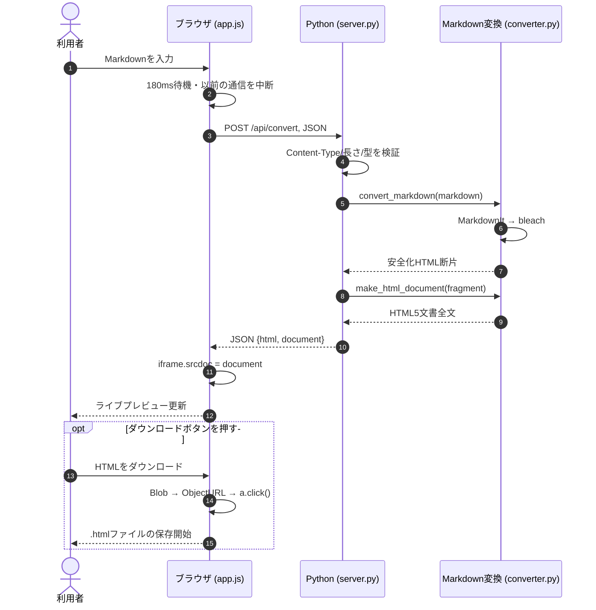

# 01｜アーキテクチャ — なぜこの構成にしたのか

## 1. 2層Webアプリケーション

このシステムは**ブラウザ（フロントエンド）**と**Python HTTPサーバー（バックエンド）**で構成します。フロントエンドがMarkdownの入力や表示に責任を持ち、バックエンドがMarkdownの構文解析・安全なHTML生成に責任を持ちます。

- **なぜ分離するのか**：解析処理の変更（Pythonライブラリ入れ替え）によってUIを大きく書き換えなくて済む。ブラウザはフォーム表示だけでなく、APIから返るデータを使って表示を更新できる。
- **状態はどこにあるか**：編集途中の文字列・最新レスポンス・表示タブなどはブラウザメモリ内。サーバーはセッションやDBを保持しない。POSTを送るたび、そのリクエスト単体で変換する。
- **HTMLはどこでできるか**：`src/converter.py` がHTML断片とHTML5文書を生成。`public/app.js` は受信結果を画面へ反映するだけ。

## 2. ディレクトリと依存関係

```text
公開される静的ファイル           公開されないサーバー側コード
┌─────────────────────────┐     ┌──────────────────────────┐
│ public/index.html       │     │ server.py                │
│  ├─ public/styles.css   │     │  └─ src/converter.py     │
│  └─ public/app.js       │────▶│      ├─ markdown_it      │
│      │                   │HTTP │      └─ bleach          │
│      └─ CDN/Monaco（任意）│◀────│                          │
└─────────────────────────┘ JSON└──────────────────────────┘

  tests/*                        learning/*（実装の学習教材）
   ├─ test_converter.py          docs/*（仕様・テスト・公開手順）
   ├─ test_server.py
   └─ browser_check.py
```

サーバーは `/`、`/index.html`、`/styles.css`、`/app.js` だけを配信します。`src`、`learning`、`.env` をHTTP経由で直接読ませないのは、意図しないファイル公開を防ぐためです。

## 3. シーケンス図



## 4. `fetch` とHTTPの境界

- `fetch('/api/convert', {...})` はクライアントがサーバーにお願いする処理。`await` は通信完了までその非同期関数の続きを待つ。
- サーバーにはリクエストメソッド・URL・ヘッダー・ボディが届く。`AppHandler` が判断してPython関数を呼び出す。
- サーバーの応答はHTMLページそのものではなくJSON。なぜなら完成HTMLとHTML断片を合わせて返したいため。
- `iframe.srcdoc` はHTML文字列をフレームの文書として表示するためのDOM属性。HTMLソースタブは `textContent` を使い、**HTMLを実行するのではなく文字列として表示**する。

## 5. 競合状態（race condition）対策

入力Aで通信を開始→ユーザーが入力Bに書き換える→通信Bが先に終了→通信Aが後から終了すると、誤って古いAがプレビューを上書きする可能性があります。

- `renderSequence`：入力が変更されるたび1増える。
- `editorChanged`：直前の `AbortController` を使って通信中断を試みる。
- `renderMarkdown(markdown, sequence)`：応答時に `sequence !== renderSequence` なら無視する。
- 最新の入力に対する変換が成功するまではダウンロードを無効にする。

中断のみでは十分ではありません。通信完了のタイミング次第で中断より先に古い応答が到着することがあるため、**シーケンス番号での照合**も行います。

## 6. セキュリティ設計の境界

1. **Markdownパーサー**：`html=False` によりユーザー入力中の生HTMLをそのまま扱わない。
2. **サニタイザ**：許可するタグと属性、URLスキームを絞る。`javascript:` やイベントハンドラを出力させない。
3. **プレビュー**：`iframe sandbox=""` により入力内容をアプリ本体とは別の制約付き文書として表示。
4. **ソース表示**：`innerHTML` ではなく `textContent` を使う。
5. **通信**：入力は上限20万文字、JSON本文は80万バイトを超えたら拒否。静的ファイルの公開URLもリスト限定。

これらは多層防御の基本です。ただし一般公開の大規模サービスに必要なレート制限・利用者認証などは実装していません。

## 7. なぜNode.jsではなくPython？

課題画像はMarkdown変換ライブラリについて複数の言語の選択肢を示しているため、今回はPythonで組みました。PythonのHTTP標準ライブラリを使うことでNodeやWebフレームワークの依存を減らし、Markdown-it-pyとBleachだけを追加できます。ブラウザ部分はJavaScriptで実装しています。

## 8. ビルドや環境変数

`PORT=8000` と `HOST=127.0.0.1` が既定値。開発時のlocalhostアクセスに限定します。Dockerfileでは `HOST=0.0.0.0` に変更し、ホストからコンテナへの通信を受け付けるようにします。APIキーやDB設定は不要です。
